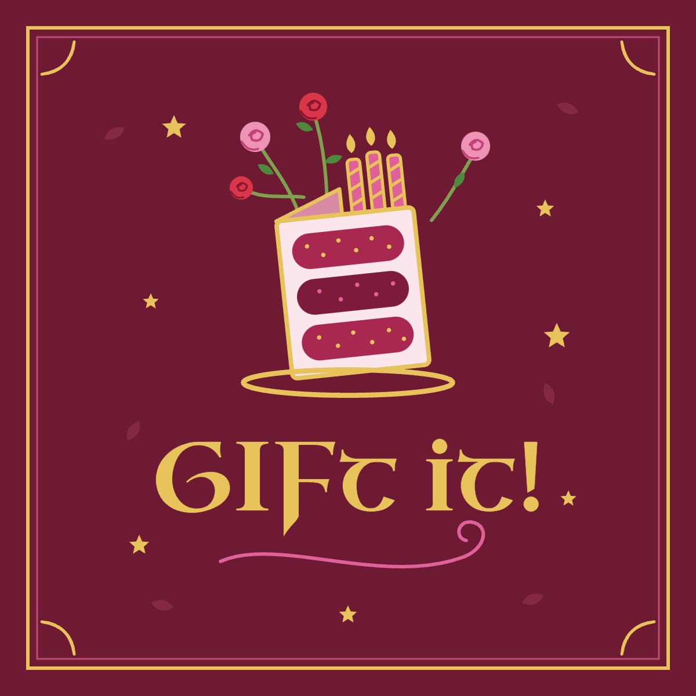

# GIFt it! – a birthday card maker

Design a birthday card on a 3D desk: pick crayons, markers, a paint brush, glitter pens, washi tape (cut with scissors), stickers and text boxes, then save it to your private portfolio or download it as a picture or animated GIF.

**Stack:** React + Three.js (frontend) · ASP.NET Core 8 (backend) · MongoDB (database) · Docker Compose. No PHP, everything free and open source.

## Run it

Helper scripts (same idea as in CampusVirtualUPT):

```bash
./deploy.sh        # build + start everything in Docker (web, API, MongoDB)  -> http://localhost:3000
./stopwebapp.sh    # stop it again (saved cards and accounts are kept)
./runlocal.sh      # run API (.NET 8) and frontend (Vite) directly on this computer, MongoDB in Docker; Ctrl+C stops
```

`deploy.sh` creates `.env` with a random `JWT_KEY` the first time and adds a random `PASSWORD_PEPPER` (keep it: changing it stops every password from working). Other ports: `WEB_PORT=3002 ./deploy.sh`,
`FRONTEND_PORT=3002 BACKEND_PORT=5081 ./runlocal.sh`. Without the scripts: `docker compose up -d --build`.

## Test it

```bash
docker build --target test backend     # ASP.NET unit tests (age rule, profanity filter)
docker build --target test frontend    # React unit tests (tape cutting, text fitting, moderation…)
scripts/smoke-test.sh                  # end-to-end API checks against the running stack
```

GitHub Actions (`.github/workflows/ci.yml`) runs the same three steps on every push.

## How to use the app

| Do this | By doing this |
| --- | --- |
| Draw | Press on a pen on the left of the desk and drag straight onto the card (or click it, then draw). Thickness, transparency and "line shape" (wobbly → ruler-straight) are in the panel at the bottom. |
| Perfect shapes | Draw a shape with any pen, crayon or brush and keep it pressed on the card for a moment at the end: your wobbly circle, oval, triangle, square, rectangle, other polygon or straight line turns into a perfect version of the same shape. Keep drawing to go back to your own line, or lift the tool to keep the perfect one. |
| Pattern pen | The rainbow-striped pen on the desk draws with shapes instead of a line: dots, bubbles, smiley faces, hearts, daisies, blossoms, stars, sparkles, smoke, a leafy vine or confetti. Choose the pattern, "My colour" or "🌈 Rainbow", size, spacing, transparency and line shape. The eraser removes it like any drawing. |
| Paint bucket | Pick up the little paint pail and click the card to fill an area with your colour: an empty folded card fills the whole side you see, an open card fills the half you click, a closed shape you drew is filled inside (shapes with gaps let the paint flow out). Lines and stickers stay on top; the eraser removes the fill. Settings: transparency and tolerance. |
| Erase drawing | Pick up the pink eraser. It removes only what was drawn; stickers, tape and text can only be removed with Undo. |
| Cut tape | Click a tape roll, drag on the card to pull tape out, release. The roll waits at the end of the tape; drag the scissors across the tape to cut it – the cut may start or end on the desk, so tape at the very edge of the card can be cut too (the card is never cut in this mode). Scissors that only move over the desk do nothing. |
| Cut the card | Pick up the scissors on their own and drag along the cut (start outside the card to cut in from an edge). If the card splits, click the piece to keep. On a folded card only the layer you cut is cut (a hole in the back cover never shows on the front). Cut edges and holes get a soft shadow so you can see them. |
| Shapes | Pick up the see-through green stencil, choose a shape (square, circle, star, heart, smiley, leaf, flower, birthday present, cake, balloon, speech bubble, and more – 37 in all) and click the card, drag a box on the card, or drag the shape from the panel onto the card. Drag the shape to move it, drag the square handles to make it bigger or smaller (Shift keeps its proportions), drag the round handle to rotate it. Shapes are outlines only, so you can colour them in with the paint bucket or the pens. Click a shape later to change it again; Delete removes it. |
| Stickers / text | Click the sticker sheet or the "Aa" pad, choose, then click the card. The text preview shows exactly how it will look; the notepad stays out of the way. |
| Change a text | With the "Aa" pad in your hand, click a text on the card: drag it to move it, drag a corner to make the letters bigger or smaller, a side to make the box wider or narrower (the words wrap like in Word), the top or bottom to make it taller, and the round handle to rotate it. The words, font, size, bold/italic and colour in the panel change it too; Delete removes it. |
| Text formatting | 87 fonts in groups like Canva and Word (Word classics such as Calibri, Cambria, Arial and Times New Roman use your own copy or a free look-alike; plus modern, elegant serif, script, handwritten, bold & fun and typewriter fonts). **B** bold, *I* italic, U underline, S strikethrough; align left, centre, right or justify (like Word); • bullets or 1. numbering for every line you type; letter spacing and line spacing sliders. All of it works on a text already on the card too. |
| Colours | Colour wheel for any colour, "💧 Pick from card" (the pointer becomes a crosshair; click the card) to copy a colour from the card, and 12 "My colours" slots: click an empty slot to put your current colour in it, click a filled slot to use its colour, double-click a filled slot to replace it with your current colour, right-click to empty it. Every project has its own palette: a new card starts empty, a saved design remembers its colours. |
| Keyboard | "⌨ Keys" (right, under the logo) lists every key. W/S (or ↑/↓) choose a setting in the tool panel (green frame), A/D (or ←/→) change it – thickness, transparency, line shape, pattern, sticker, shape, font, or the next colour from My colours. Zoomed in, W A S D / arrows move around the card (hold Shift to change settings instead). |
| Hide menus | The tool panel at the bottom has "▾ Hide" (or press H) so the whole card is free to draw on while you use that tool; the small "show options" button in the bottom-left corner brings it back, and it comes back by itself when you pick up another tool. The Turn card and Background pop-ups close with ✕ or Esc, and the zoom map has its own Hide button. |
| Zoom | "🔍 Zoom in" (or +) splits the screen: the tools stay on the left, the card is magnified on the right (up to 8×) and you can keep drawing there. Set the amount with the slider or the mouse wheel; the zoom map (top right) shows the whole card with a red frame for what you see – click or drag it (or use the arrow keys) to look elsewhere. With no tool in your hand, dragging in the zoomed view moves around the card like a map (it never opens, picks up or turns the card). "↩ Zoom out" (or −) goes back to the normal view. |
| Reset rotation | "🎯 Reset rotation" at the top puts the card back flat, the way it started. |
| Pick up and turn the card | With no tool in hand, click the card. Drag to turn it (Shift = diagonal); click it or the desk to put it down. "Turn card" at the top turns it on three axes: vertical, longitudinal, diagonal. Both sides can be decorated. |
| Gift points & shop | With an account you start with 100 gift points (they expire if you don't use the app for 30 days; bought items stay) and get 50 more the first time you download each new card that has something on it, as a picture or a GIF (saving to the portfolio gives no points; up to 10 cards a day). The "🎁 points" button (right, under the logo) opens the gift shop, with realistic pictures of everything (the real 3D tools, tape rolls and cards, a sheet of stickers): coloured paper (60 each, or "All coloured paper" for any colour, 400), sticker packs (120), tape packs (100 – any tape roll can wear the new designs), tool designs (150 – golden, pastel or wooden tools) and two new drawing tools (200 each, see below). Everything you buy stays with your account, in every card. "▶ Try it" lets you play with anything first on a separate practice card (coloured paper, tools in their new look, stickers, tapes, the new tools); a bar on top has Buy and "Back to my card", which brings your own card back untouched (the practice card can't be saved or downloaded). Choose the paper with the "Paper" button – it only appears once you own a coloured paper; it is saved with the card. |
| Calligraphy pen & spray can | Two drawing tools you can buy in the gift shop; they then lie on your desk next to the pens. The calligraphy pen has a flat nib held at 45°, so strokes are broad going one way and hairline-thin the other – lovely for lettering. The spray can sprays a soft, speckled mist with a few droplets; going over a spot again makes it stronger. Both have thickness, transparency and line shape, and wear your tool design. |
| Menu | Click the GIFt it! logo in the top-right corner: your account, saving to your portfolio, opening your portfolio, downloading pictures and GIFs, new card. While you are zoomed in, the logo is hidden (zoom out to use the menu). |
| Card size | The "📐" button under the logo (shows the current size, e.g. A4), at any time; the design is scaled to fit and Undo brings the old size back. |
| Account | The menu (click the logo) shows your name, email and Log out in a big box at the top. Click the round picture (📷) to use a photo from your computer as your profile photo – it is cut to a square and made small automatically; "Remove photo" shows your initial again. |
| Log in / sign up | Your display name, email and password are written on long strips of paper. When you finish a strip (Enter, Tab or click elsewhere) a rubber stamp comes down and stamps exactly what you wrote; click a stamped strip to write it again. The password has 👁 Show / Hide: shown, the stamp prints your password; hidden, it prints dots. |
| Security | Passwords are never stored: only an Argon2id hash with its own random salt and a secret pepper kept outside the database. New passwords need at least 10 characters and can't be a very common one or contain your name or email. After 5 wrong passwords in a row the account is locked for 15 minutes. The web server sends strict security headers (Content-Security-Policy and others). |
| Create an account | Your date of birth is chosen on a calendar page that looks like a tear-off calendar: click the month or the year in the top-right corner to choose them, then turn the pages (7 days per page, "Next page ›", the arrow keys or the mouse wheel) and click your birthday – it turns red with a little "my birthday!" note. You must be at least 14. |
| Portfolio | Menu → Open my portfolio: a full page with big pictures of your saved cards – each one closed, front cover facing you, with everything on it, on the background colour it was saved with – to open, download or delete them. "← Back to my card", Esc or the browser's Back button return to the card. |
| Background colour | "Background" at the top: pastel list or "Any colour…". It is remembered when you refresh the page, and every saved card keeps its own background colour (you can change it again any time). |
| Undo / Erase all | Undo keeps up to 150 steps. "Erase all" asks for confirmation in the app, then clears both sides, tape, stickers, text and cuts (it can be undone too). |
| Put a tool down | Click an empty spot on the desk (not the card) to leave it there; on a spot that is taken you get a friendly "Oops! This place is occupied…" message and keep the tool in your hand. If the card later covers a tool, the tool rolls out to the nearest free spot. "Put it back" sends it to its usual place – or, if that is taken, to the nearest free place nearby, then the right side of the card, then anywhere free. "🧹 Put all tools back" (top bar, always there) tidies the whole desk. "Put it back", Esc or right-click returns it to its usual place. |
| Open / close the card | The card starts folded on its front cover. Drag it sideways to open or close it – from the front or the back, in any rotation: the sheet nearest to you turns towards you. While you hold the card (a drag turns it), use "Open card" / "Close ←" / "Close →" at the top or the O key, which work in any position. |

## Rules from the project brief and where they live

| Rule | Implementation |
| --- | --- |
| Marks can never leave the card, background can't be drawn on | Drawing happens on canvases mapped onto the card; pointer hits are raycast against the card only, and cut-away paper is ignored (`frontend/src/scene/Card.jsx`). Text boxes are scaled and clamped inside the card (`placeTextBox`). |
| Stickers can't be written over, tape can | A hidden "protect" mask is filled by stickers and cleared by tape (`engine/paper.js`). |
| Eraser removes drawing only | Each side has separate layers: objects (tape, stickers, text) and ink (drawing). The eraser only touches ink. |
| Every tool behaves differently | `engine/brushes.js` (crayon grain + multiply blending, marker transparency, highlighter layering, uneven brush bristles, glitter sparkles). |
| Tape cut is a straight line, irregular rectangles only | `cutTapeStrip` in `engine/geometry.js` (unit-tested). |
| Card cuts: any shape, choose the piece to keep | `finishCut` + `labelPieces` (`engine/pieces.js`, unit-tested). |
| Account only for 14+ | Checked in the form **and** on the server (`backend/CardApi/Rules.cs`, tested). |
| Portfolio: private, 20 slots, one slot per design | `backend/CardApi/Program.cs`; saving again updates the same slot. Both sides, cuts and layers are saved. |
| No vulgar drawings or curse words | Text: client + server profanity filter (also on titles and names). Drawings: in-browser NSFW image model (`imageModeration.js`) checks both sides before save/export. |
| Exports use the current background colour | `export/layouts.js` (6 picture + 6 animation layouts, inside or outside, GIF via `gifenc`). |

## Project layout

```
backend/    ASP.NET Core 8 minimal API + xUnit tests (+ Dockerfile with a `test` stage)
frontend/   React + react-three-fiber app, Vitest tests, nginx (+ Dockerfile with a `test` stage)
scripts/    smoke-test.sh
docs/       architecture, CI/CD & deployment, marketing, Instagram
.github/    CI and release workflows
```

More: [docs/ARCHITECTURE.md](docs/ARCHITECTURE.md) · [docs/CI-CD-AND-DEPLOYMENT.md](docs/CI-CD-AND-DEPLOYMENT.md) · [docs/MARKETING.md](docs/MARKETING.md) · [docs/INSTAGRAM.md](docs/INSTAGRAM.md)

## Known limits (honest list)

- The image check is a general-purpose NSFW classifier, so it catches explicit imagery but not every rude doodle. Text is checked with a word list, which can be dodged with creative spelling. Add reporting/human review before a public launch.
- Glitter sparkles twinkle live but are not stored with a saved design (the glitter texture is).
- Text boxes stay inside the card's rectangle; if part of the card has been cut away, text over the missing paper is simply not shown.
- The sign-up/login endpoints allow 20 requests per minute per IP, so running `scripts/smoke-test.sh` several times in a row can hit that limit (wait a minute).
